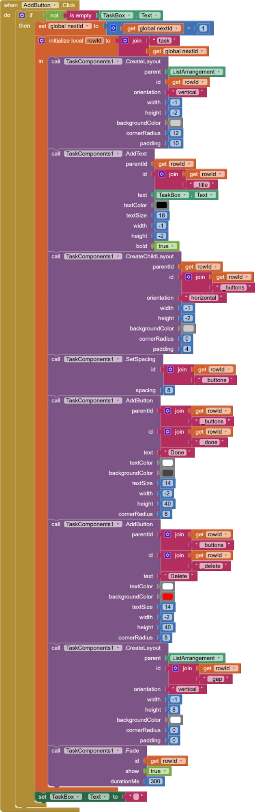
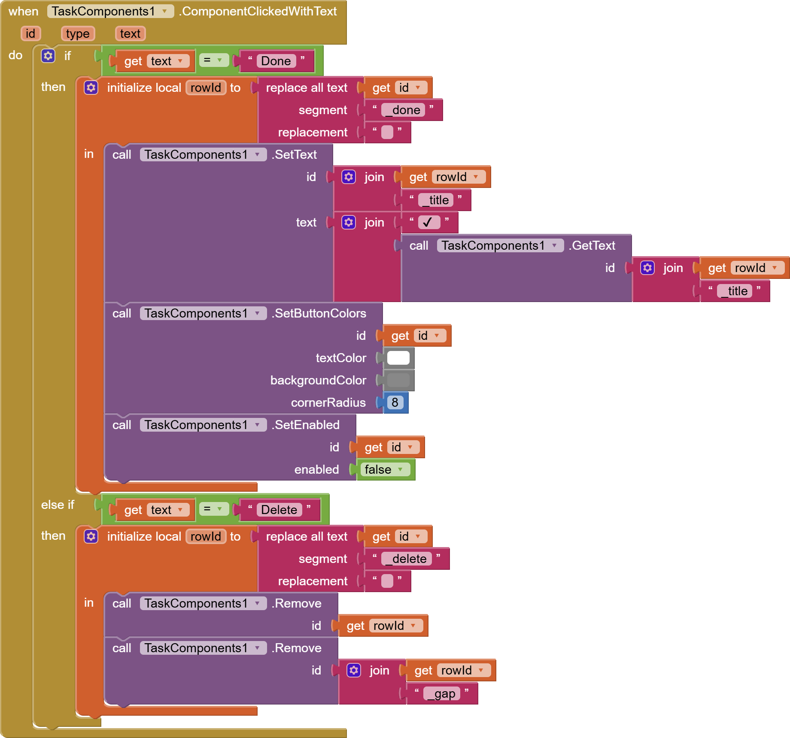
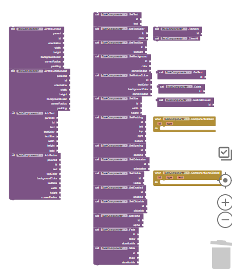
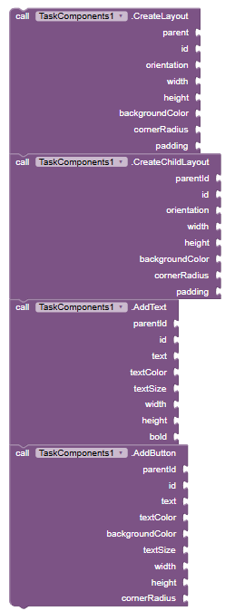
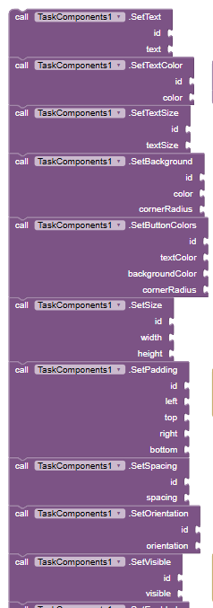
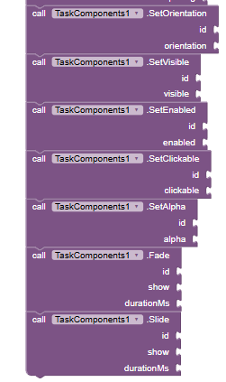
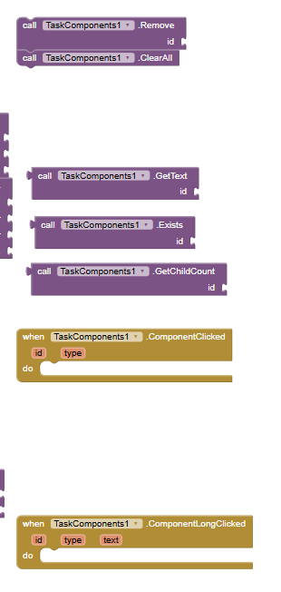

# TaskComponents

A free, open-source **MIT App Inventor extension** for building UI at runtime. Create native Android layouts, labels and buttons from blocks, give each one an ID, and change, animate or remove it later.

It was built for a task list app where every task is a row (title, description, timer, status, and Start / Stop / Complete / Delete buttons) that is created from data instead of being placed by hand in the Designer.

**[⬇ Download TaskComponents 1.0.0 (.aix)](https://github.com/TechnoTypist/TaskComponents/releases/latest)**

- Non-visible extension, min SDK 21
- Package: `com.technomc.taskcomponents`
- License: MIT

## Features

- Create vertical or horizontal layouts inside any App Inventor arrangement, including scroll arrangements.
- Nest layouts inside each other, and add labels and buttons to any of them.
- Every component has your own text ID, so you can update it later (`SetText`, `SetVisible`, `SetButtonColors` and more).
- Rounded corners, background colors, padding and spacing.
- Fade and slide animations.
- Click, click-with-text and long-click events that tell you which button was pressed.
- `Remove` deletes one component and everything inside it. `ClearAll` removes everything the extension created, so you can rebuild a list from scratch.

## Quick start

1. Download the `.aix` from the [latest release](https://github.com/TechnoTypist/TaskComponents/releases/latest).
2. In App Inventor: **Palette → Extension → Import extension**, then choose the file.
3. Drag **TaskComponents** onto your screen.
4. In the Designer, add a **VerticalScrollArrangement** with a **VerticalArrangement** inside it (for example `ListArrangement`). Set both widths to **Fill parent**.
5. In the blocks:
   - `CreateLayout(parent = ListArrangement, id = "row1", orientation = "vertical", width = -1, height = -2, …)`
   - `AddText(parentId = "row1", id = "row1_title", text = "My task", …)`
   - `CreateChildLayout(parentId = "row1", id = "row1_buttons", orientation = "horizontal", …)`
   - `AddButton(parentId = "row1_buttons", id = "row1_start", text = "Start", …)`
6. Handle clicks with **when TaskComponents1.ComponentClicked** and check the `id`.

Each call to `CreateLayout` with the same parent adds a new row **below** the previous one.

## Example project

[`example/TaskComponentsDemo.aia`](example/TaskComponentsDemo.aia) is a small to-do app built with TaskComponents. Type a task and tap **Add** to get a row with **Done** and **Delete** buttons; **Clear all** removes every row. Import it with **Projects → Import project (.aia) from my computer**. The extension is already included.

**Adding a task row**



**Handling the row buttons**



## Units

| Value | Meaning |
|---|---|
| width / height | dp. `-1` = Fill parent, `-2` = Automatic |
| textSize | sp |
| colors | App Inventor color blocks (ARGB integers) |
| orientation | the text `vertical` or `horizontal` |

## Blocks



### Creating



| Block | What it does |
|---|---|
| `CreateLayout(parent, id, orientation, width, height, backgroundColor, cornerRadius, padding)` | Adds a layout inside an App Inventor arrangement. |
| `CreateChildLayout(parentId, id, orientation, width, height, backgroundColor, cornerRadius, padding)` | Adds a layout inside another layout ID. |
| `AddText(parentId, id, text, textColor, textSize, width, height, bold)` | Adds a label. |
| `AddButton(parentId, id, text, textColor, backgroundColor, textSize, width, height, cornerRadius)` | Adds a button. |

### Changing

 
| Block | What it does |
|---|---|
| `SetText(id, text)` / `GetText(id)` | Set or read a label or button's text. |
| `SetTextColor(id, color)` / `SetTextSize(id, size)` | Text style. |
| `SetBackground(id, color, cornerRadius)` | Background color and rounded corners. |
| `SetButtonColors(id, textColor, backgroundColor, cornerRadius)` | Both button colors at once. |
| `SetSize(id, width, height)` | Resize. |
| `SetPadding(id, left, top, right, bottom)` | Inner padding in dp. |
| `SetSpacing(id, spacing)` | Gap between a layout's children in dp. |
| `SetOrientation(id, orientation)` | Switch a layout between vertical and horizontal. |
| `SetVisible(id, visible)` / `SetEnabled(id, enabled)` / `SetClickable(id, clickable)` | State. |
| `SetAlpha(id, alpha)` | Transparency, 0 to 1. |
| `Fade(id, show, durationMs)` / `Slide(id, show, durationMs)` | Animations. |

### Removing, checking and events


| Block | What it does |
|---|---|
| `Remove(id)` | Removes a component and everything inside it. |
| `ClearAll()` | Removes every component this extension created. Your Designer arrangements stay. |
| `Exists(id)` | True if the ID exists. |
| `GetChildCount(id)` | Number of direct children in a layout. |

### Events
| Event | When |
|---|---|
| `ComponentClicked(id, type)` | A button was tapped. |
| `ComponentClickedWithText(id, type, text)` | Same, plus the button's current text. |
| `ComponentLongClicked(id, type, text)` | A button was long-pressed. |

## Tips

- IDs must be unique. Creating a component with an ID that already exists does nothing, so call `ClearAll` (or `Remove`) before rebuilding a list.
- A simple naming pattern keeps things easy to find, for example `task3`, `task3_status`, `task3_start`.
- Pass the **VerticalArrangement inside your scroll arrangement** as the `parent` of `CreateLayout`. Passing the scroll arrangement itself also works.

## Building from source

Requires [Rush](https://github.com/shreyashsaitwal/rush-cli) and JDK 17 or newer.

```bash
git clone https://github.com/TechnoTypist/TaskComponents.git
cd TaskComponents
rush build
```

The `.aix` is written to `out/`.

## How rows stay stacked

App Inventor arrangements don't hand an extension their real `LinearLayout`; `getView()` returns a `FrameLayout` wrapper around it. Views added to that wrapper all draw in the top-left corner, on top of each other. TaskComponents looks through the wrapper to the arrangement's inner vertical `LinearLayout`, so every row you create is placed below the last one.

## Credits

Built with [Rush](https://github.com/shreyashsaitwal/rush-cli) 2.x (2.1.2) by Shreyash Saitwal, the extension builder for MIT App Inventor.

## Changelog

- **1.0.0** (2026-11-11): first public release.

## License

MIT. See [LICENSE](LICENSE).
